<p align="center">
  
</p>

# KARDS Toolbox（KARDS 工具箱）

[中文](README.md) | [English](README_en.md)

KARDS Toolbox 是面向 Kards 玩家的卡牌、卡组和卡包本地管理工具。

当前版本：**1.2.19**。

## 界面概览

| 1. 卡组管理 | 2. 卡组构筑 |
| :---: | :---: |
| 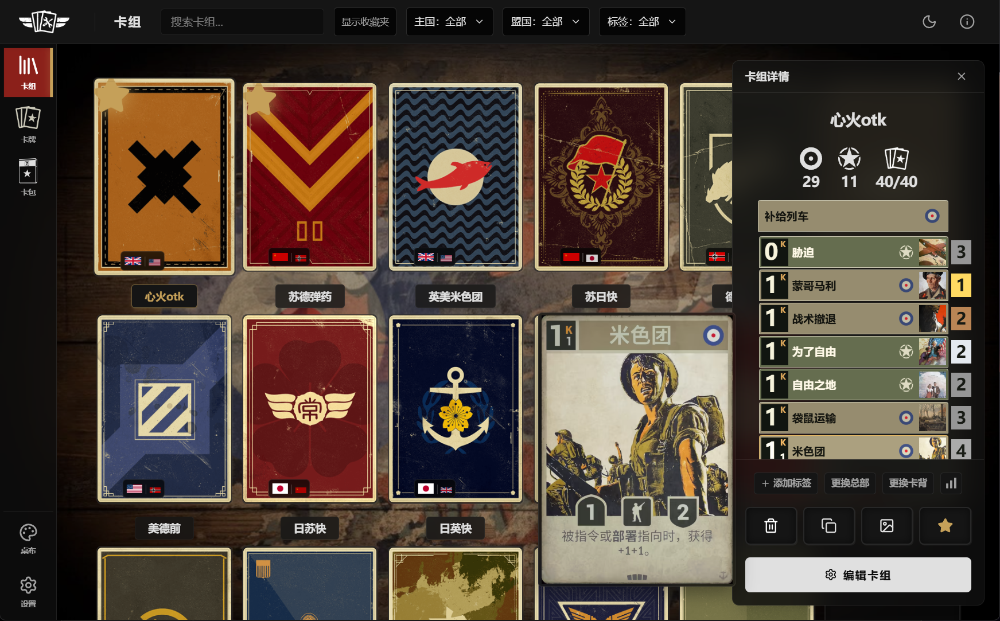 | 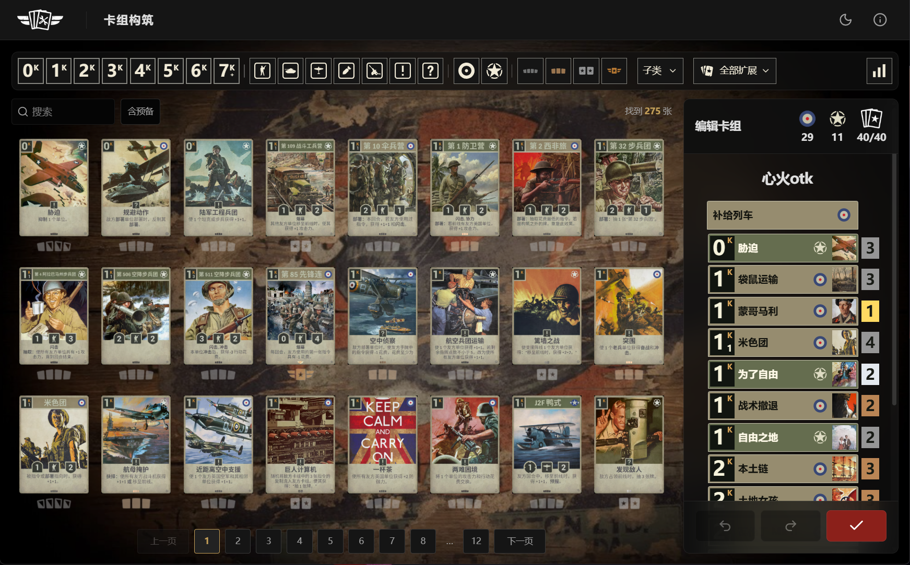 |
| **3. 卡组分析** | **4. 卡牌资料库** |
| 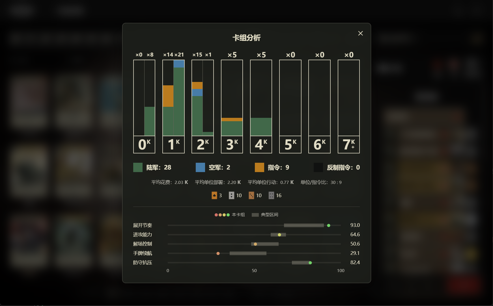 | 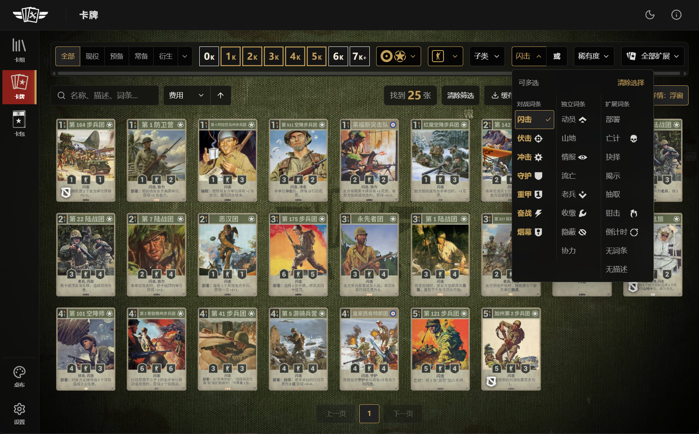 |
| **5. 卡牌详情** | **6. 卡包选择** |
| 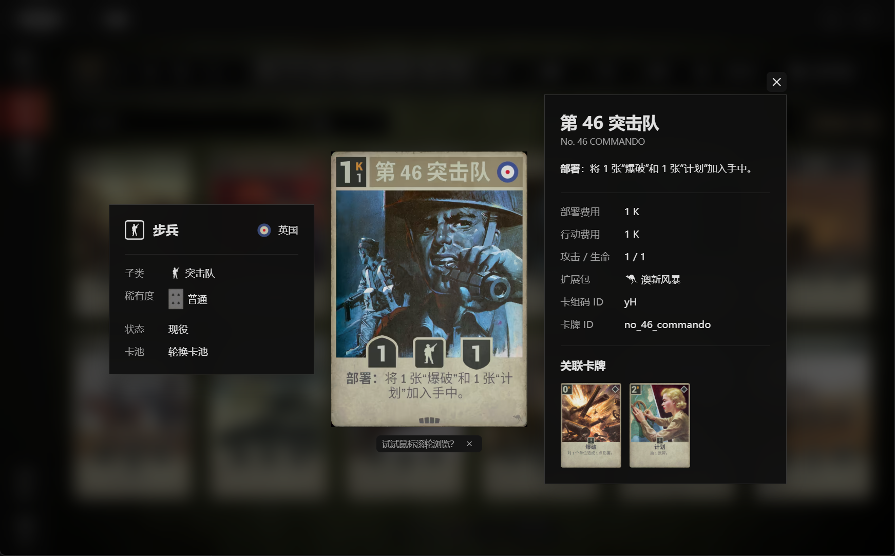 | 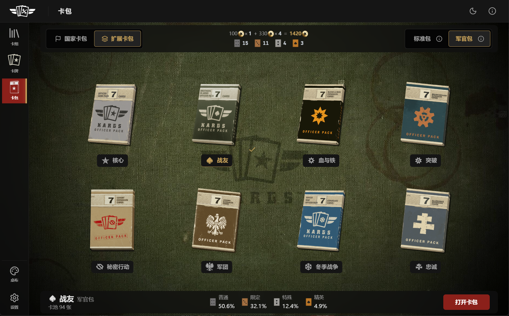 |
| **7. 模拟开包** | **8. 卡组分享图** |
| 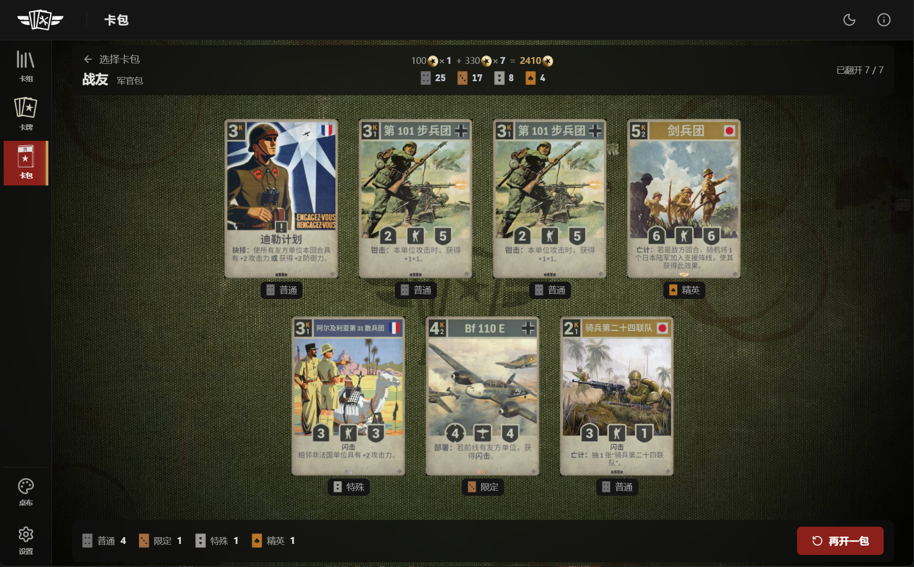 | 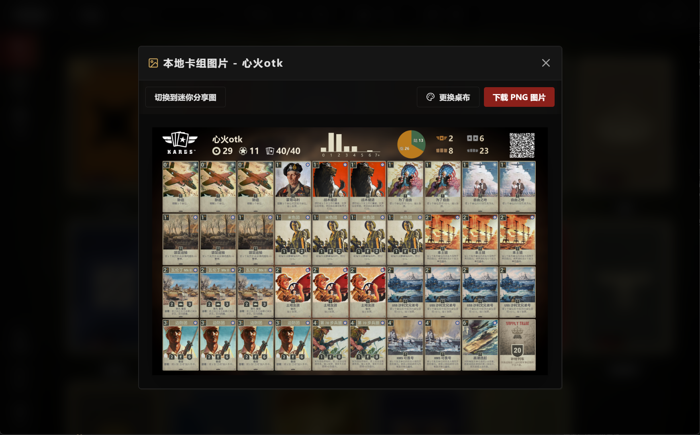 |
| **9. 卡组迷你图** | **10. 一键卡组生图** |
| 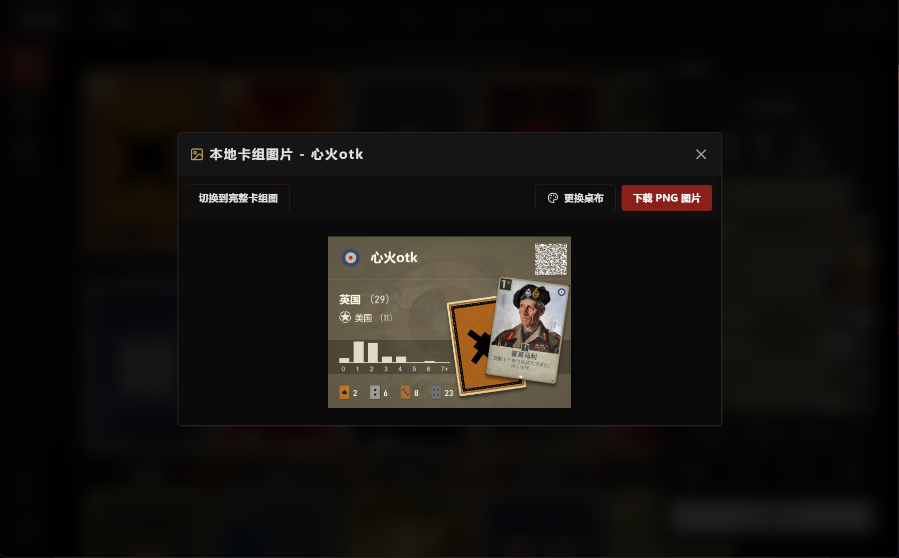 | 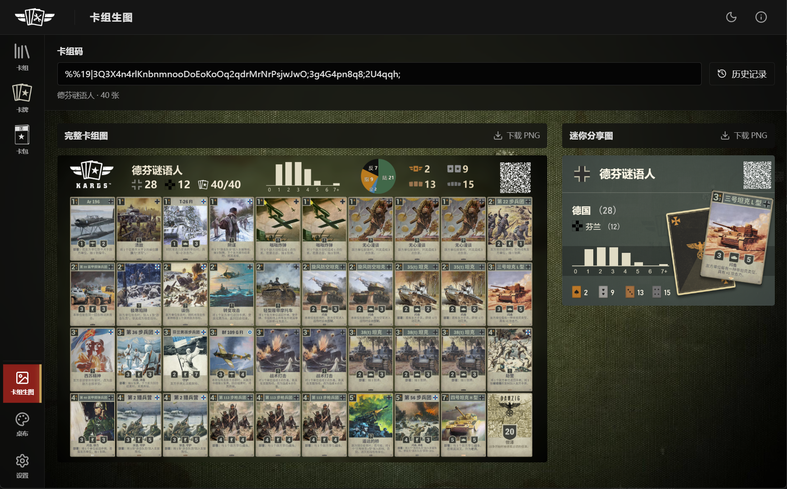 |
| **11. 自定义桌布** | **12. 数据与缓存管理** |
| 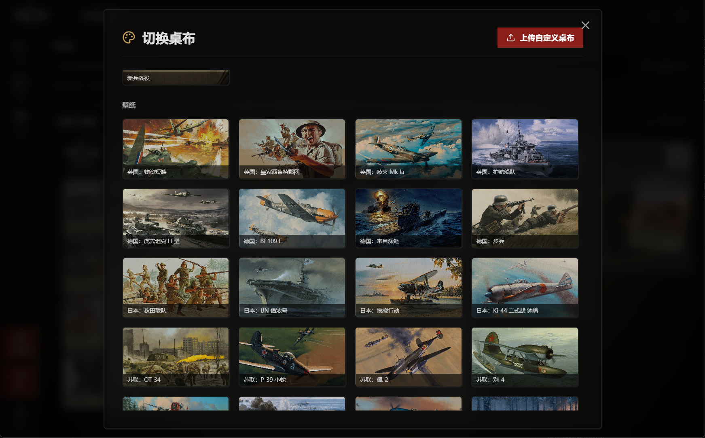 | 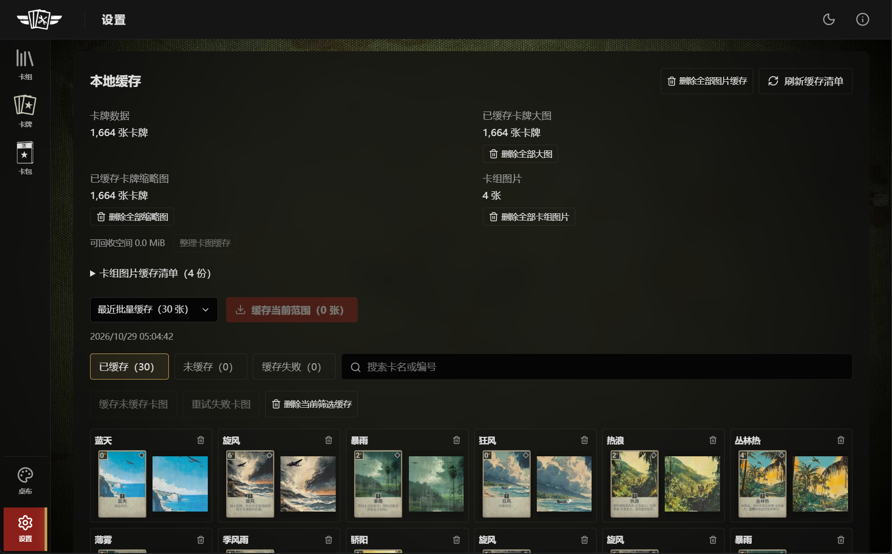 |

## 使用说明

### 卡组

- “新卡组”提供新建、战备卡组和卡组码导入。可为卡组设置名称、收藏、标签及收藏夹；打开“收藏夹显示”后按文件夹展开浏览。
- 战备卡组以国家配色的缩略卡片展示主盟国、费用曲线、稀有度数量和叠放卡图；预览及添加后均使用预设的非默认主国卡背。选中后查看介绍，再添加到卡组。
- “导入卡组”可选择卡组图片，优先读取二维码中的卡组名、总部、卡背和卡组码；没有可用二维码时，Windows 桌面版使用本机文字识别尝试还原标题及卡组。识别结果先填入窗口，核对后确认导入；文字识别可能遗漏卡牌。
- 单击卡组固定打开右侧详情，双击进入构筑；未选中卡组时，悬停可临时预览。详情浮层不挤压卡组网格，点击外部空白或按 Esc 关闭。
- 详情中可复制卡组码、生成本地 PNG，以及更换卡背和总部。图片预览中的“更换桌布”只影响本次生图；“切换到迷你分享图”生成战备封面风格的高清 PNG，预览保持 342×242，导出分辨率为 1368×968，包含牌数、费用分布、稀有度、实际卡背和分享二维码，可切回完整卡组图。
- 悬停“更换卡背”右侧的“卡组分析”按钮可查看卡组统计，移开即关闭；此处不支持点击固定。
- 生成图右上角包含卡组名、总部、卡背标识和卡组码的二维码，兼容不含卡背信息的旧图片。自定义卡背按本地标识恢复，资源不存在时使用主国默认卡背；识别与生成均在本地完成。

### 卡组生图

- 左栏“桌布”上方的“卡组生图”可直接输入卡组码，无需先保存卡组；也可粘贴游戏内的完整卡组文本。进入页面或应用重新获得焦点时，检测到剪贴板中的新卡组码会自动填入。
- 输入有效卡组码后自动刷新完整卡组图和迷你分享图，两种预览均可下载 PNG，点击图片可在背景模糊的浮窗中放大查看，点击空白或按 Esc 关闭。已保存的同码卡组沿用名称、总部和卡背，否则按主盟国自动命名；生图使用本地资源及卡图缓存。
- 完整卡组图使用毛玻璃桌布，顶部中间显示与迷你图相同的 0—7+ 费用柱状图，以及陆军、空军、指令、反制指令的数量饼图；饼块沿用卡组分析配色，直接标注“陆/空/指/反”和加粗数量，不计总部。
- 点击上方“历史记录”打开与卡组详情同样式的右侧浮栏，自动查找本地卡组图缓存，包括从卡组详情生成的图片；每条记录显示完整图与迷你图缩略图，缺少迷你图时自动补生成。点击记录回填卡组码并显示缓存图片。记录随用户备份导出和恢复。

### 卡组构筑

- 单击卡池卡牌或详情中的卡牌条查看资料；双击卡池卡牌或构筑卡牌条加入一张，右键移除一张，也可在卡池和右侧清单之间拖动。
- 上行依次使用费用、类型、国家、稀有度、子类和扩展筛选，下行左侧为搜索及“含预备”，右侧显示结果数量。类型、国家与稀有度直接点击图标多选；窗口变窄时按类型、稀有度、国家顺序收为菜单。卡池只展示主国及盟国可选卡牌，滚轮翻页；卡组数量包括一张总部。
- 悬停筛选栏最右侧的“卡组分析”按钮预览当前卡组的 0K—7K+ 花费分布，按陆军、空军、指令、反制分类；有行动花费的档位左半为部署分布、右半为行动分布。下方显示平均花费、平均单位部署、平均单位行动、单位/指令比及稀有度分布；单位含陆军和空军，指令数含反制，均按实际张数统计且不计总部。移开鼠标后关闭；点击按钮则固定浮窗并模糊背景，可点击外部或按 Esc 关闭。
- 构筑方式随卡组内容自动判断：不含预备卡为“排位/休闲模式”，含预备卡为“经典模式”。超限时提示并标红，保存不足张数时需确认；卡牌数超过 5 张后隐藏主国、盟国选择栏。
- 右下角提供撤回、重做及保存并退出。离开有修改的卡组时可选择保存或放弃。

### 卡牌

- 按名称、规则文字、阵营、类型、子类、词条、费用、稀有度、扩展包及状态查找卡牌；多语言文字可用于搜索，“.”匹配任意单个字符（例如“护.船队”）。中文名忽略空格和标点符号，“第13”可匹配“第 13 龙骑兵团”；单位支持按数值搜索：`x1404` 按部署费/行动费/攻击/防御匹配，`x104` 忽略行动费，各指定属性限个位数。阵营、类型、子类、词条、费用和稀有度支持多选，词条可切换“或”（命中任一项）或“和”（命中全部项）匹配。状态使用全部、现役、预备、常备、衍生五个互斥按钮；衍生右侧菜单可多选老兵、天气、研发、惩戒、其他；部分子项选中时仅点亮展开按钮，全选时同时点亮“衍生”。搜索框右侧可一键清空；搜索结果不超过 3 张时在卡池中央偏下提示可扩大搜索范围，不占用卡牌排版空间；无结果时显示“当前条件下搜索+筛选无结果”；存在筛选时，按可用结果显示两个入口：“单独搜索”保留搜索词并清除筛选，“单独筛选”清空搜索词并保留筛选；无可用入口时仅显示标题。词条菜单按对战、独立、扩展分三列，支持倒计时名单、无词条及无描述筛选；有配套资源的词条在文字右侧显示透明底图标。
- 搜索右侧可按费用、行动费用、攻击力、防御力、中文名或英文名排序，默认费用升序。箭头或 A-Z/Z-A 切换方向；主排序相同时依次按费用、类型升序排列，再保留牌库顺序；同组天气按原体、变体 1、变体 2 相邻展示。
- 卡图完整展示，点击默认以浮窗查看详情、关联卡和总部；缓存按钮旁可切换“卡牌详情：浮窗/侧栏”，选择会自动保存。非衍生卡的稀有度配有万能卡，可悬停放大；普通统一使用通用万能卡，其余稀有度优先使用对应国家版本；衍生卡不显示稀有度；词条、子类、扩展包显示配套图标；老兵卡继承本体扩展包并参与相应筛选，衍生卡详情不显示扩展包项。可点击首页、尾页及附近页码跳转，也可用滚轮在可见网格中翻页。
- “缓存卡牌图片”下载当前全部筛选结果的完整图与缩略图。下载在后台继续，右下角显示进度、速度、剩余时间，可暂停、继续或调整间隔与并发数。

### 卡包

- 左侧“卡包”进入本地模拟开包。先选择国家卡包或扩展包，再选择标准包（5 张）或军官包（7 张）；卡池包含对应来源的非衍生卡。选包时，在窗口左半侧滚动切换国家/扩展卡包，右半侧滚动切换标准/军官包，上下滚动均切至另一项。
- 标准包至少包含 1 张限定或以上；军官包至少包含 2 张限定或以上，其中至少 1 张特殊或以上。选包底部展示基础出卡概率，保底在抽取后补足；顶部规格旁的“i”可悬停查看对应来源的卡包说明。盟国图标每 2 秒轮换，扩展包使用配套标志；卡包尺寸与间距随窗口宽高调整。
- 单卡基础概率按普通/限定/特殊/精英依次为：标准包 74.6% / 19.9% / 4% / 1.5%，军官包 50.6% / 32.1% / 12.4% / 4.9%。军官包可开出通用万能牌：在每个稀有度卡池中加入一份对应通用万能牌，与该等级每张卡牌等概率抽取，计入原有 7 张及保底；标准包不出万能牌。
- 顶栏中央记录本机累计开包历史：标准包按 100、军官包按 330 计算模拟总花费，下行使用通用万能牌图标统计四种稀有度的累计张数（含万能牌）。开包即计入，翻牌、返回或切换页面不重复计数；重启后保留，并随用户备份导出和恢复。
- 点击“打开卡包”或双击卡包后逐张翻开，或选择“全部翻开”；翻卡节奏随稀有度变化。翻开的卡可点击查看详情，全部翻开后可“再开一包”，Esc 返回选包。盟国卡使用其对应国家的卡背。结果仅在本次模拟中展示。

### 设置与数据

- 用户数据位于 `%APPDATA%\kards-toolbox`。下载 ZIP 发布版后，完整解压再启动 `kards_toolbox.exe`。
- 左侧底部进入设置。卡牌数据更新流程为：选择 kardsplayer.com（默认）或 kards.com → 获取数据 → 核对新增、修改、移除 → 应用更新；支持回退上次快照。
- 牌库不会在启动时自动更新。查看缺失卡图时可联网缓存；更新卡牌资料只更新数据和图片地址，不批量下载图片。
- “本地缓存”分别统计牌库卡数、大图覆盖数和缩略图覆盖数，可查看已缓存、未缓存和失败项，批量缓存、重试、删除或整理缓存以回收空间。
- 用户备份包含卡组、收藏夹、设置、草稿、用户图片及卡组图片缓存；普通卡图缓存和卡牌数据库单独管理。升级或换机前可先导出备份。
- 本地数据读取失败时停止自动保存，可重试读取、导入备份或恢复自动备份；保存失败时显示提示并支持重试。启动及导入前保留最多 3 份不同的自动备份，可在设置的“数据备份”中恢复；自动备份包含用户数据与开包历史，不重复保存可重新生成的卡组图片。备份内容先整体校验，恢复中断会回滚，重启时也会先完成未结束的回滚。
- 桌布从左侧入口选择，提供有名称的默认桌布及按国家与卡牌中文名命名的壁纸，深浅主题从顶栏月亮/太阳按钮切换；设置自动保存。总部专属桌布只在选中或编辑相应卡组时临时显示。

## 快捷键

| 操作 | 快捷键 |
| --- | --- |
| 关闭详情、弹窗或取消当前操作 | Esc |
| 确认操作 | Enter；多行输入框保留换行 |
| 构筑保存并退出 | Ctrl+Enter |
| 构筑撤回 / 重做 | Ctrl+Z / Ctrl+Y 或 Ctrl+Shift+Z；输入框保留文本编辑行为 |
| 卡池上一页 / 下一页 | 在卡池中滚动滚轮，或使用页码按钮 |

详情下方的滚轮使用提示可关闭，关闭后不再显示；设置“数据备份”右侧可重新显示所有使用 Tips。

卡牌详情浮窗支持滚轮逐张查看，侧栏模式下鼠标停留在详情内时生效；顺序沿用来源卡池或卡组，并同步翻页或滚动卡牌条。末页只显示剩余卡牌。

## 从源码运行

需要 Windows 10/11 x64、Node.js 22 和 npm。源码仓库不包含游戏静态素材；桌面运行前需要按 [资源准备](docs/build-and-run.md#静态资源与源码仓库) 自行准备有权使用的资源或兼容资源包。在项目目录执行：

```powershell
npm ci
npm run dev:desktop
```

## License

本项目中的代码和文档采用 [MIT License](LICENSE)。KARDS 商标、游戏素材、卡牌资料、截图中的游戏内容和第三方依赖分别适用其原有权属及许可，详见 [第三方内容与许可证](THIRD_PARTY_NOTICES.md)。本工具非官方项目。

更多内容：[构建与运行](docs/build-and-run.md) · [项目架构](docs/architecture.md) · [界面规范](DESIGN.md) · [贡献指南](CONTRIBUTING.md) · [安全报告](SECURITY.md)。
