<p align="center">
  
</p>

# KARDS Toolbox（KARDS 工具箱）

中文 | [English](README_en.md)

KARDS Toolbox 是面向 Kards 玩家的卡牌、卡组和卡包本地管理工具。

当前版本：**1.4.1**。

## 界面概览

| 1. 欢迎页 | 2. 卡组管理 |
| :---: | :---: |
| 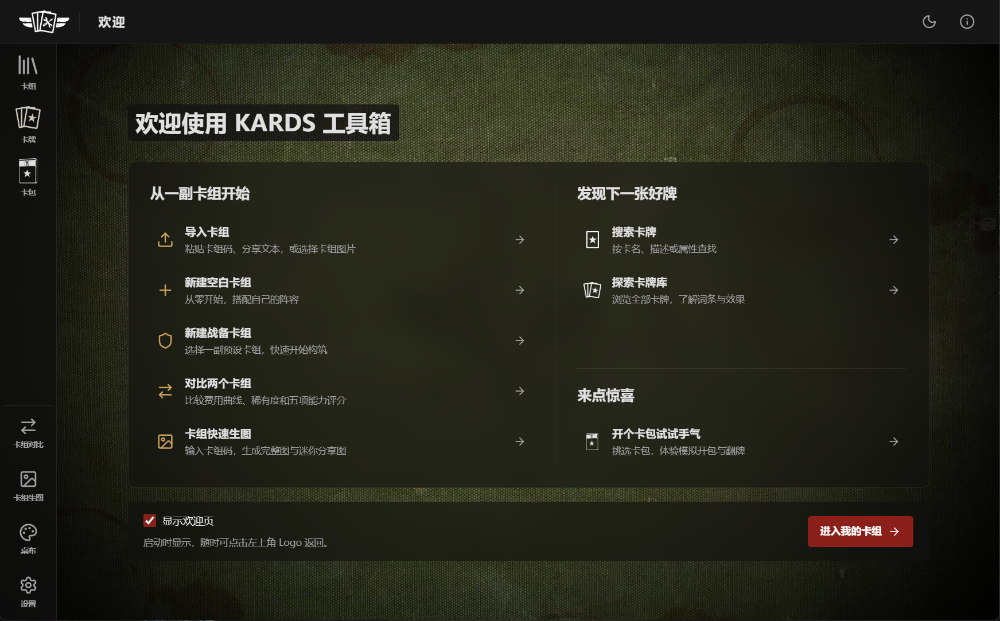 | 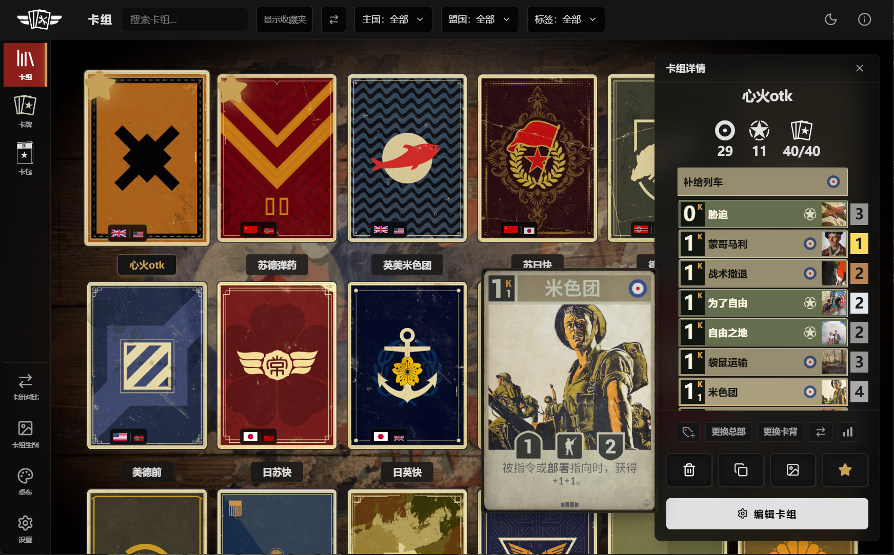 |
| **3. 卡组构筑** | **4. 卡组分析** |
| 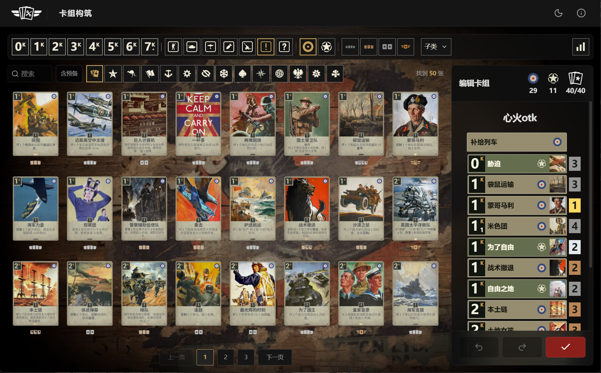 | 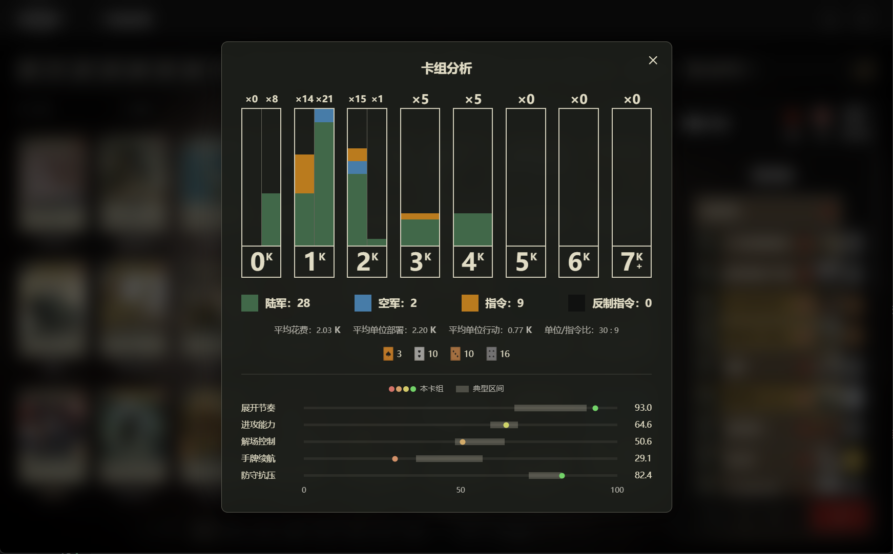 |
| **5. 卡牌资料库** | **6. 卡牌详情** |
| 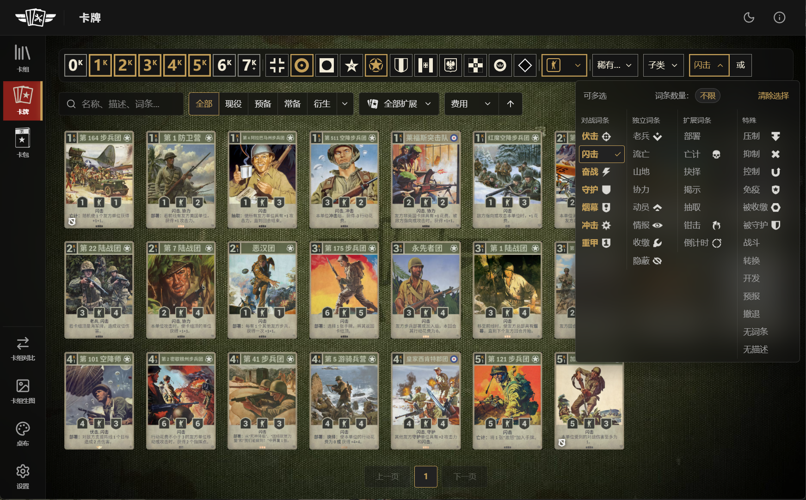 | 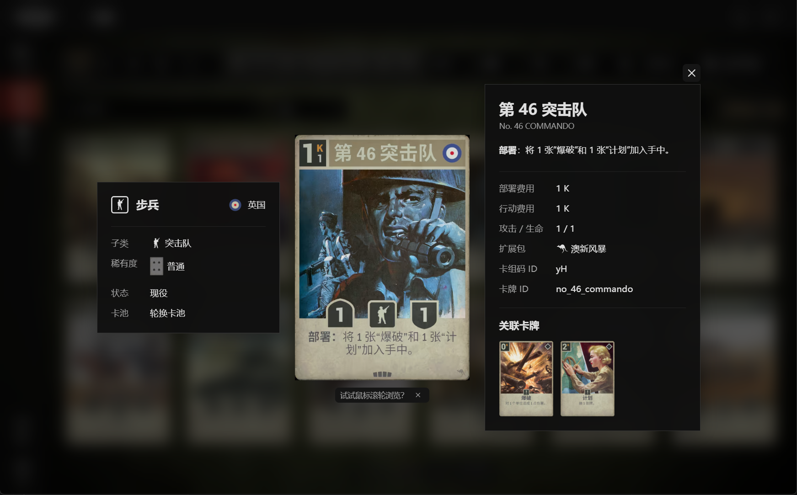 |
| **7. 卡包选择** | **8. 模拟开包** |
| 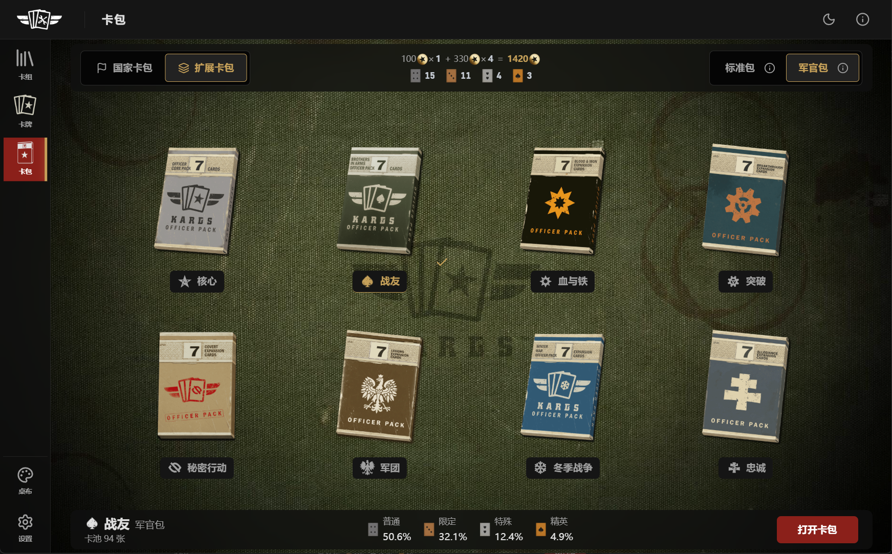 | 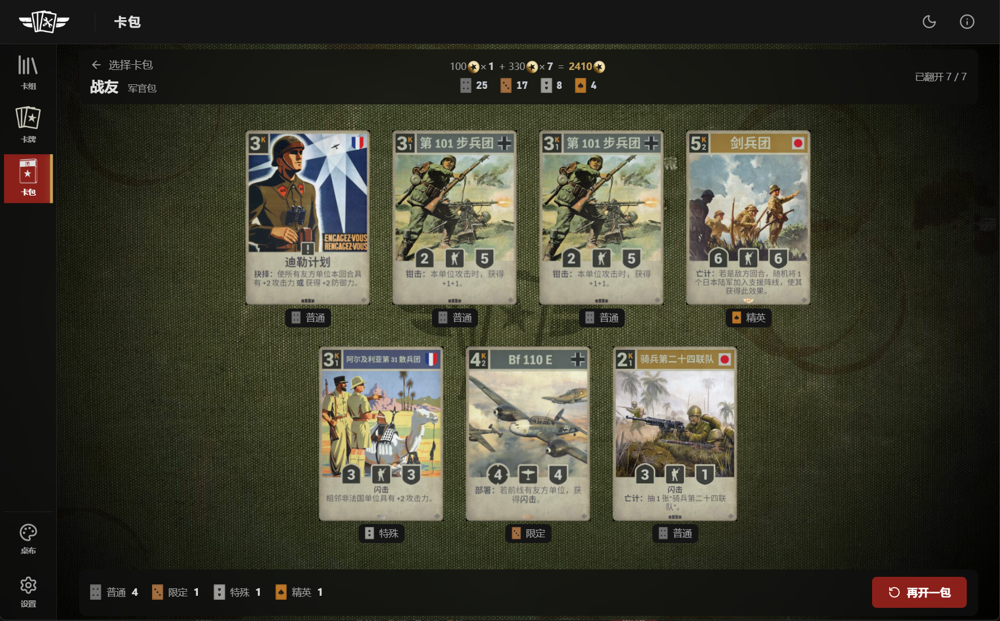 |
| **9. 卡组对比** | **10. 卡组分享图** |
| 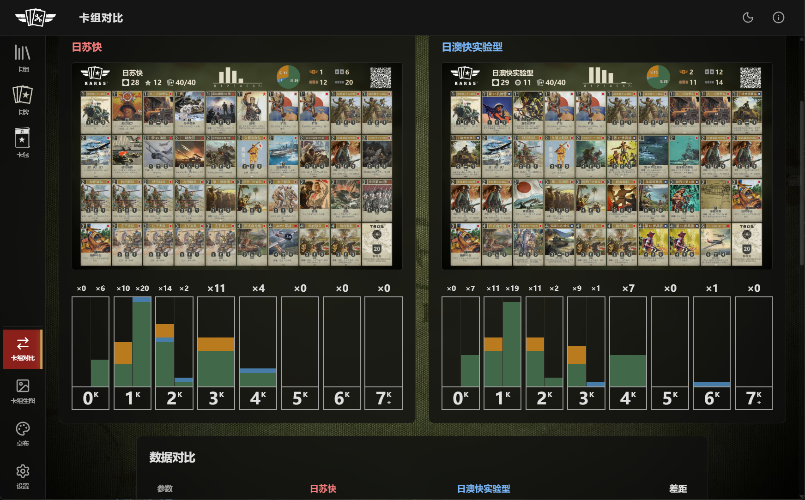 | 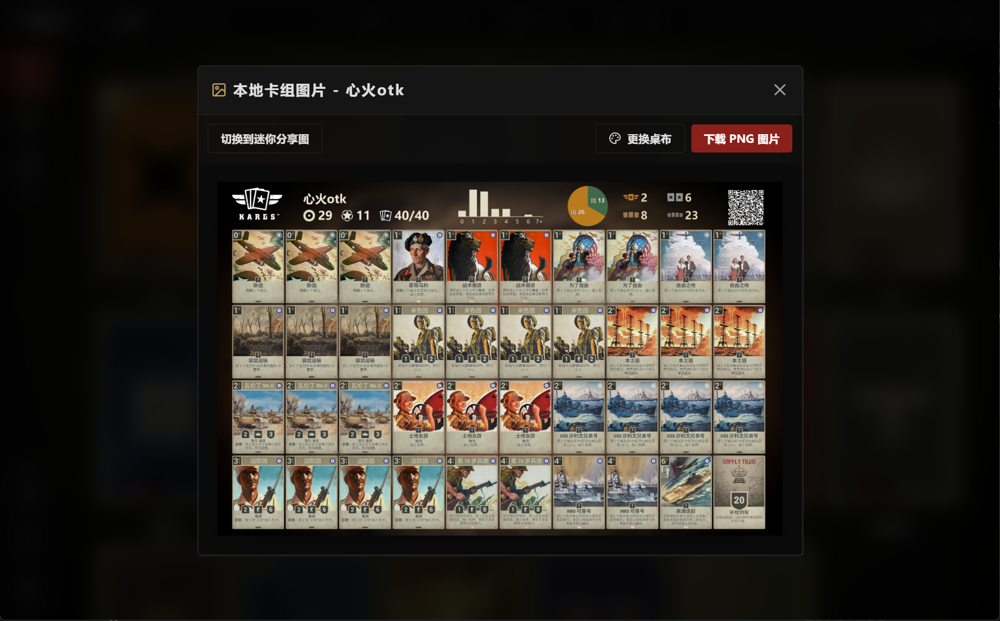 |
| **11. 卡组迷你图** | **12. 一键卡组生图** |
| 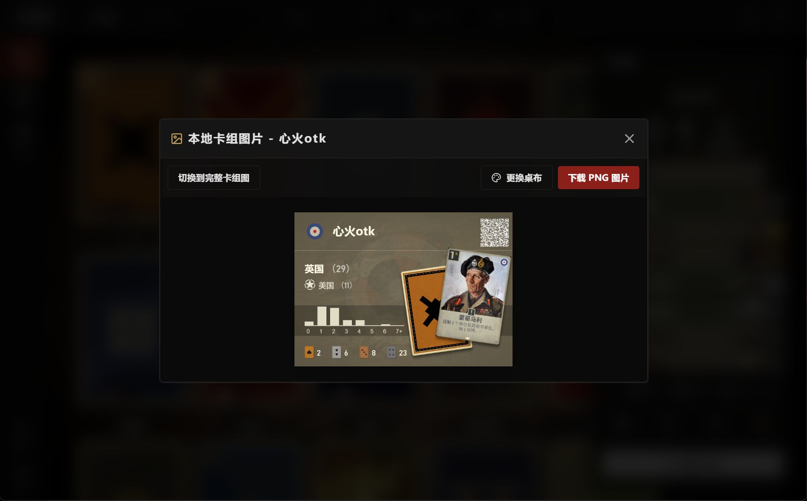 | 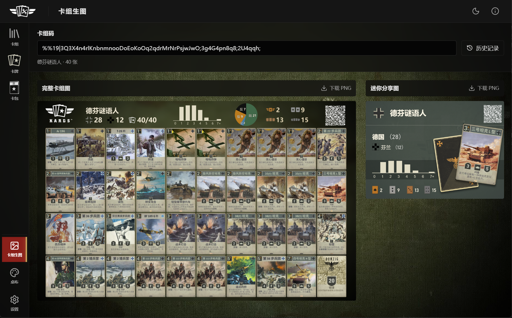 |
| **13. 自定义桌布** | **14. 数据与缓存管理** |
|  | 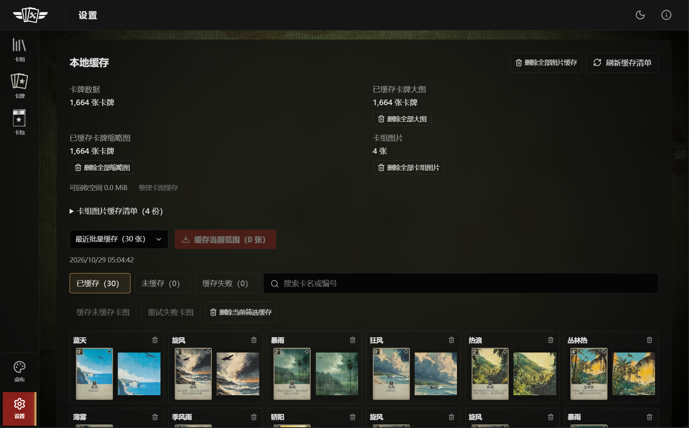 |

## 使用说明

### 快捷键

| 操作 | 快捷键 |
| --- | --- |
| 关闭浮窗或取消当前操作 | Esc |
| 确认操作 | Enter |
| 构筑保存并退出 | Ctrl+Enter |
| 卡组构筑撤销 | Ctrl+Z |
| 卡组构筑恢复 | Ctrl+Y 或 Ctrl+Shift+Z |
| 卡池翻页 | 鼠标滚轮 |
| 卡牌详情换卡 | 鼠标滚轮 |
| 卡包类型切换 | 鼠标滚轮（在左/右半屏功能不同） |

### 卡组分析/卡组对比怎么看？

**卡组分析入口**：

| 1. 卡组详情右下角 | 2. 卡组构筑右上角 |
| :---: | :---: |
| 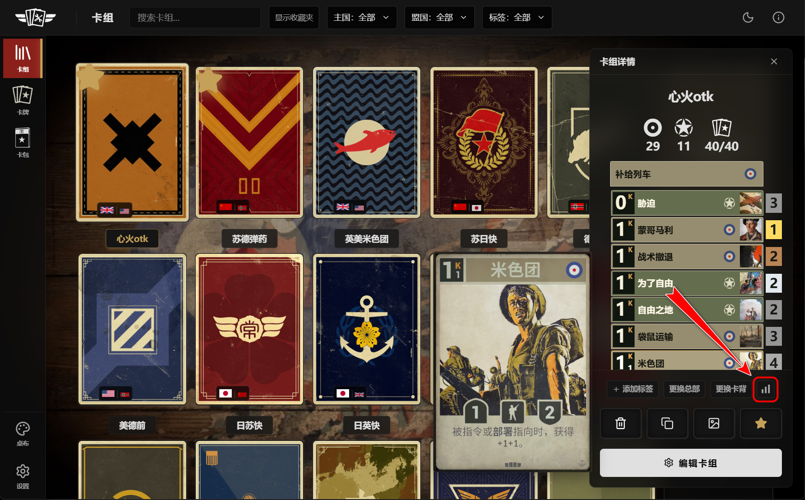 | 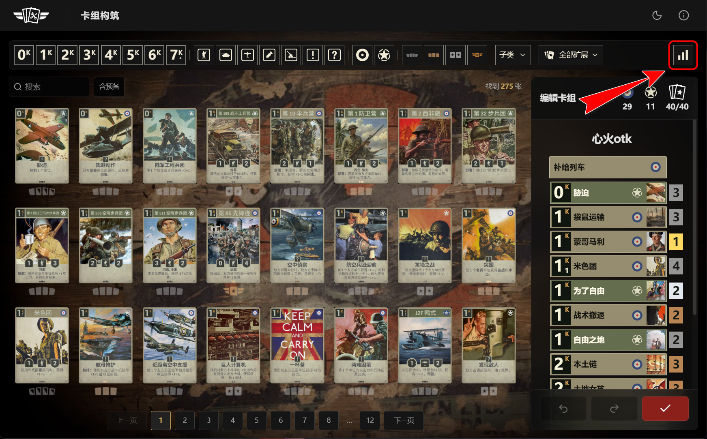 |

**一图流**：

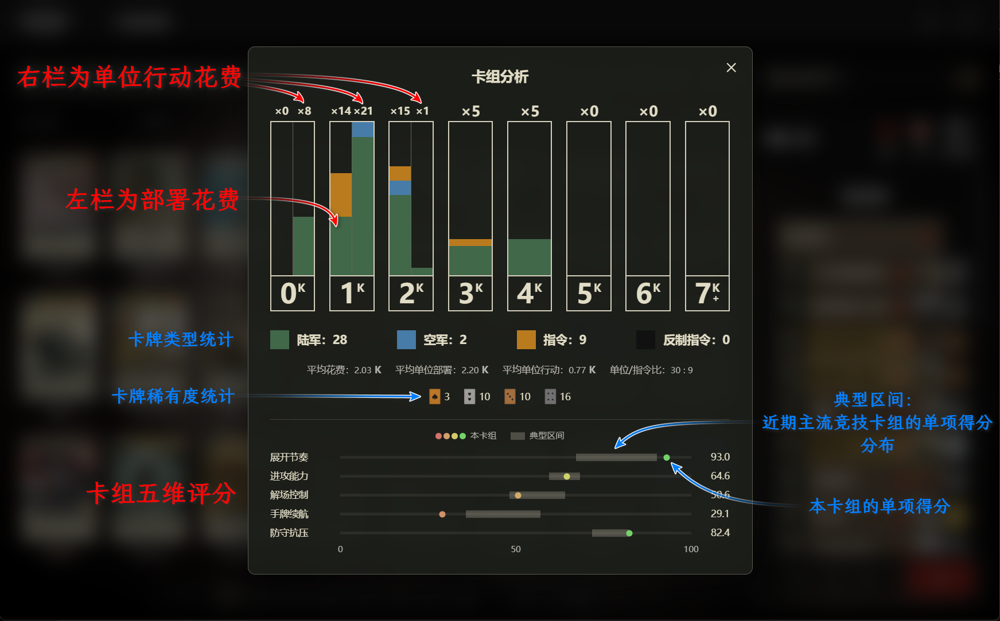

**卡组评分**：

卡组评分是卡组分析的核心部分，通过对卡组的经济、控制、连锁及净代价进行估算，给出五项能力评分，帮助玩家更好地了解和优化自己的卡组。评分范围为 0—100，越高表示该项能力越强。

| 评分项 | 说明 |
| --- | --- |
| 展开节奏 | 能否及时铺场、连续出牌，以及利用跳费、降费加快部署。 |
| 进攻能力 | 能否通过单位攻击、成长和直伤，持续威胁敌方总部。 |
| 解场控制 | 能否处理敌方单位（压制、抑制、控制等），并通过弃牌、加费、封锁等手段干扰对手。 |
| 手牌续航 | 扣除弃牌、自残等代价后，能否持续补充可用手牌，避免空手。 |
| 防守抗压 | 能否依靠占线、交换、修复和保护（免疫、烟幕、守护等），抵御进攻、维持生存。 |

## 从源码运行

需要 Windows 10/11 x64、Node.js 22、npm、Go 1.26.2 或更新版本，以及 WebView2 Runtime。桌面运行需要自行准备有权使用的游戏素材或兼容资源包。[资源准备](docs/build-and-run.md#静态资源与源码仓库)

```powershell
npm ci
npm run dev:desktop
```

## License

本项目中的代码和文档采用 [MIT License](LICENSE)。KARDS 商标、游戏素材、卡牌资料、截图中的游戏内容和第三方依赖分别适用其原有权属及许可，详见 [第三方内容与许可证](THIRD_PARTY_NOTICES.md)。本工具非官方项目。

更多内容：[功能详情](docs/feature-details.md) · [构建与运行](docs/build-and-run.md) · [项目架构](docs/architecture.md) · [界面规范](DESIGN.md) · [贡献指南](CONTRIBUTING.md) · [安全报告](SECURITY.md)。
