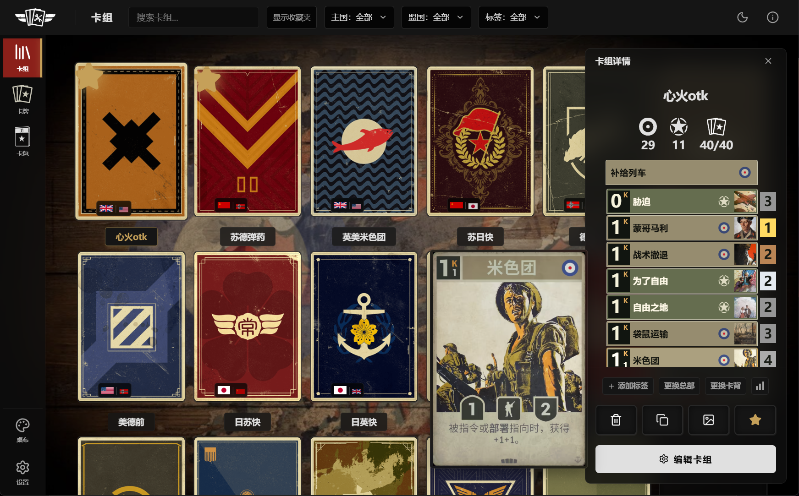
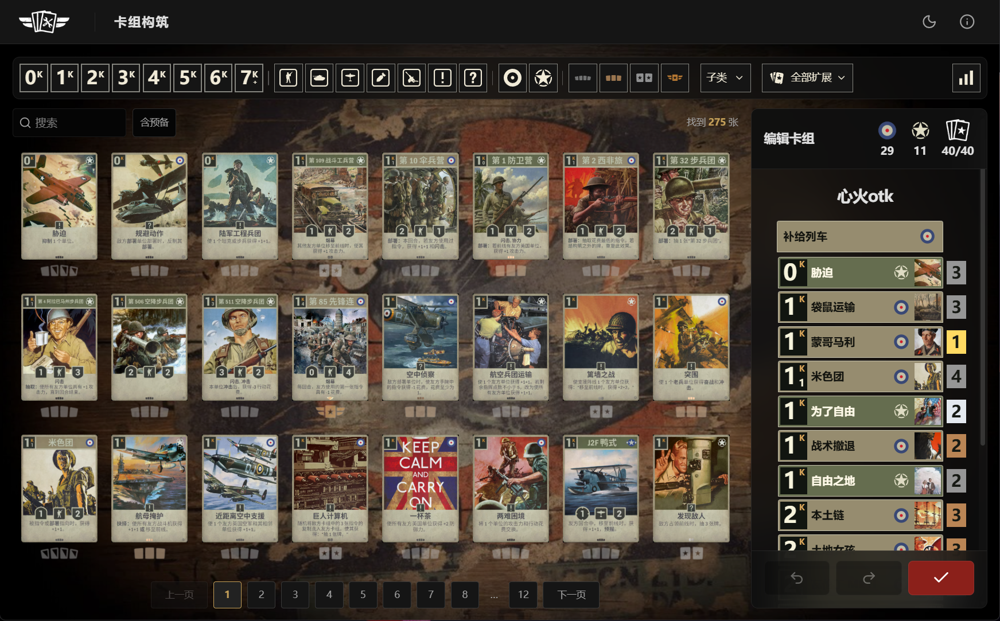
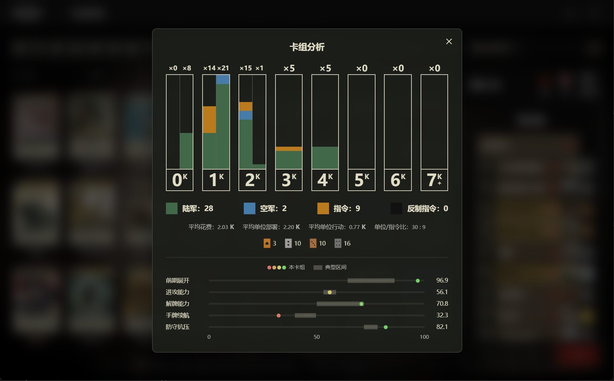
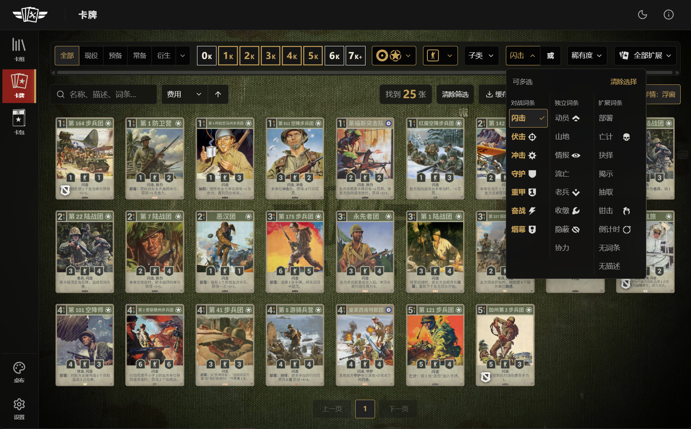
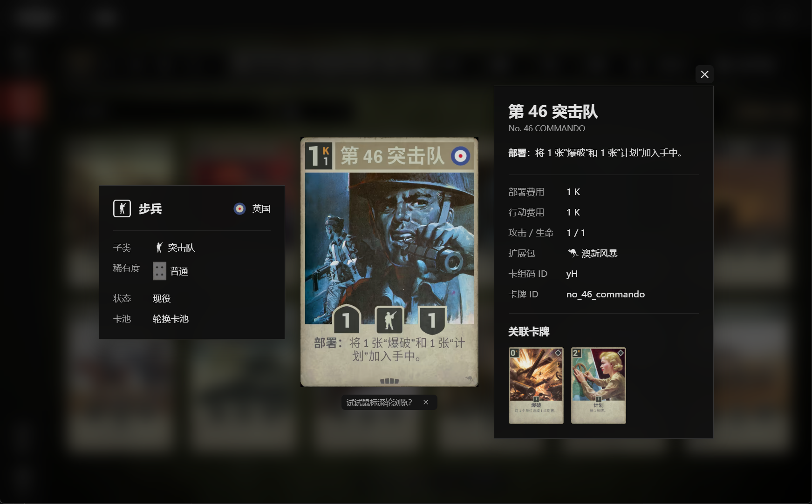
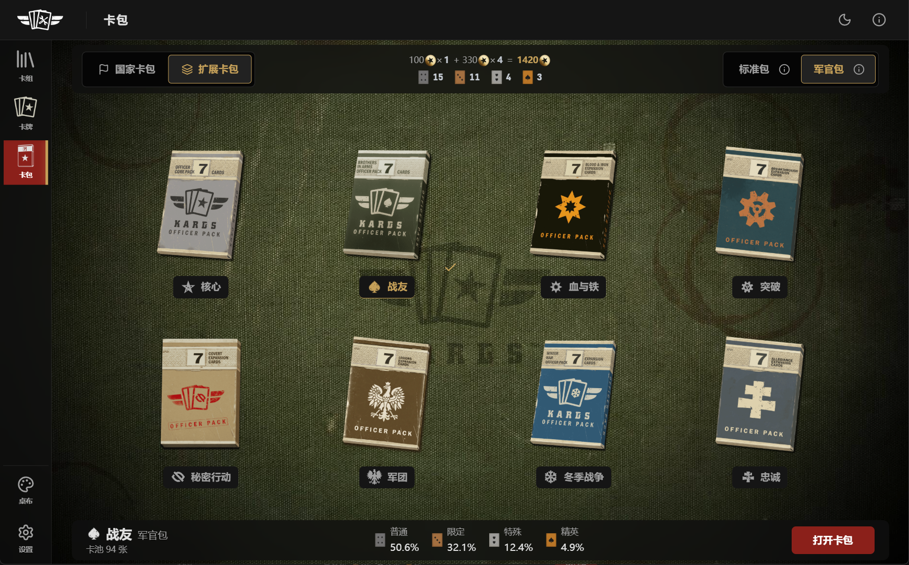
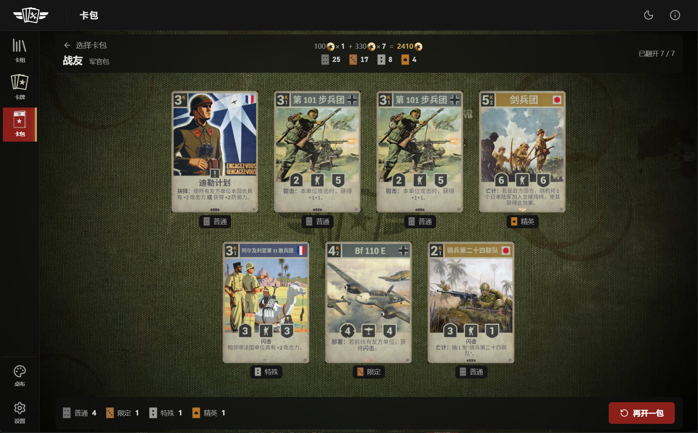
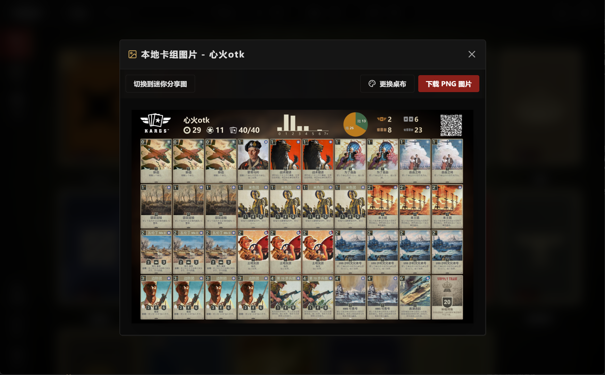
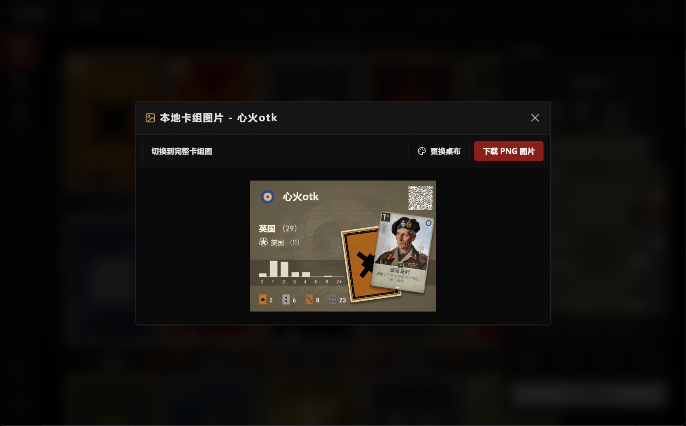
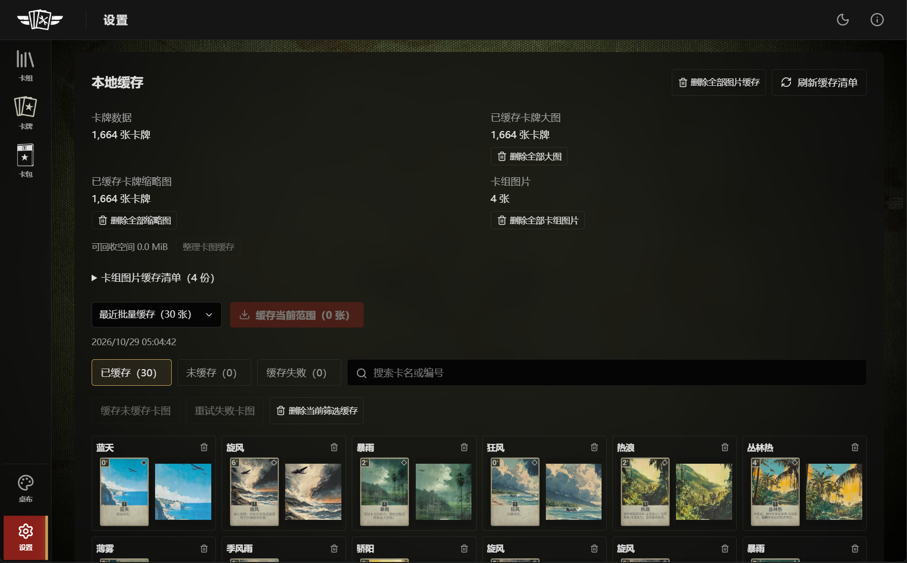

<p align="center">
  
</p>

# KARDS Toolbox

[中文](README.md) | [English](README_en.md)

KARDS Toolbox is a local tool for KARDS players to browse cards, build and manage decks, and simulate opening card packs.

Current version: **1.3.0**.

## Screenshots

| 1. Deck management | 2. Deck builder |
| :---: | :---: |
|  |  |
| **3. Deck analysis** | **4. Card library** |
|  |  |
| **5. Card details** | **6. Pack selection** |
|  |  |
| **7. Pack opening simulation** | **8. Deck sharing image** |
|  |  |
| **9. Mini deck image** | **10. Data and cache management** |
|  |  |

## Usage

The control names below are English descriptions of the Chinese interface shown in the screenshots.

### Decks

- **New deck** lets you create a deck, choose a ready-made deck, or import a deck code. Set a name, mark favorites, add tags, and organize decks into folders. Enable the folder view to browse decks by folder.
- Ready-made decks appear as compact cards in their nation's colors, with main and allied nations, a cost curve, rarity counts, and stacked card artwork. Previews and added decks use the preset non-default card back for the main nation. Select a deck to read its description before adding it.
- **Import deck** accepts deck images. It first reads the deck name, headquarters, card back, and deck code from a QR code. If no usable QR code is found, the Windows desktop app attempts to recover the title and deck using local text recognition. Review the populated fields before confirming; text recognition may miss cards.
- Click a deck to keep its details open on the right, or double-click to edit it. When no deck is selected, hovering shows a temporary preview. The details overlay does not shrink the deck grid; click outside it or press Esc to close it.
- Deck details let you copy the code, generate a local PNG, and change the card back or headquarters. Changing the tablecloth in the image preview affects only that export. **Switch to mini sharing image** generates a high-resolution PNG styled like a ready-made deck cover: the preview is 342×242 and the exported image is 1368×968. It includes the card count, cost distribution, rarity counts, actual card back, and sharing QR code. You can switch back to the full deck image.
- Hover over **Deck analysis**, to the right of **Change card back**, to view deck statistics. Five ability scores appear at the bottom as horizontal dots against typical ranges from 12 sample decks; unannotated or updated cards use estimates from printed attributes and common effects, while incomplete decks or missing data show a status instead. This preview closes when you move away and cannot be pinned by clicking.
- Generated images include a QR code in the upper-right corner containing the deck name, headquarters ID, card back ID, and deck code. Older images without card back information remain compatible. Custom card backs are restored by their local IDs; if the resource is unavailable, the main nation's default back is used. Recognition and image generation run locally.

## Deck image shortcut

- Open **卡组生图** above the tablecloth button in the left sidebar. Enter a deck code or paste the full in-game deck text; a new valid code in the clipboard is filled automatically on entry and when the app regains focus.
- Full and mini sharing images refresh automatically and can each be downloaded as PNG. Click either image to enlarge it over a blurred backdrop; click outside or press Esc to close. Saved decks with the same code retain their name, headquarters and card back; other codes use a name based on their nations.
- Full exports use a frosted background. The header includes a 0–7+ cost curve and a pie chart for army, air, orders and countermeasures, using the deck analysis colors and direct labels with bold counts. Headquarters are excluded.
- **历史记录** opens a floating sidebar styled like deck details, listing local deck image caches, including images generated from deck details. Each entry shows full and mini thumbnails; missing mini images are generated automatically. Select an entry to fill its code and restore its cached image. These caches are included in user backups.

### Deck builder

- Click a card in the pool or a card strip in the details to inspect it. Double-click a pool card or a deck card strip to add one copy, right-click to remove one, or drag cards between the pool and the list on the right.
- The top row contains cost, type, nation, rarity, subclass, and expansion filters. The lower row contains search and **Include reserves** on the left, with the result count on the right. Type, nation, and rarity icons support multiple selections. As the window narrows, type, rarity, and nation filters collapse into menus in that order. The pool shows only cards available to the main and allied nations. Use the mouse wheel to change pages; the deck count includes one headquarters card.
- Hover over **Deck analysis** at the far right of the filter bar to preview the deck's 0K–7K+ cost distribution, grouped into ground units, air units, orders, and countermeasures. For cost bands with operation costs, the left half shows deployment costs and the right half shows operation costs. Statistics below include average cost, average unit deployment cost, average unit operation cost, the unit-to-order ratio, and rarity counts. Units include ground and air units; orders include countermeasures. All statistics use actual copy counts and exclude the headquarters. Move away to close the preview, or click the button to pin it with a blurred backdrop. Click outside or press Esc to close a pinned view.
- The deck's contents determine its mode: decks without reserve cards use **Ranked/Casual**, while decks with reserve cards use **Classic**. Limits are highlighted in red; saving an incomplete deck requires confirmation. Main and allied nation selectors are hidden once the card count exceeds five.
- Undo, redo, and **Save and exit** are available in the lower-right corner. When leaving a modified deck, choose whether to save or discard your changes.

### Cards

- Find cards by name, rules text, nation, type, subclass, keyword, cost, rarity, expansion, and status. Multilingual text is searchable. A period (`.`) matches any single character, as in `护.船队`. Chinese name searches ignore spaces and punctuation: `第13` matches `第 13 龙骑兵团`. For units, `x1404` matches deployment cost / operation cost / attack / defense; `x104` omits operation cost. Each specified value must be a single digit.
- Nation, type, subclass, keyword, cost, and rarity filters support multiple selections. Keywords can match **OR** (any selected keyword) or **AND** (all selected keywords). Status uses five mutually exclusive options: **All**, **Active**, **Reserve**, **Permanent**, and **Generated**. The menu next to **Generated** supports multiple selections from Veteran, Weather, Research, Reprisal, and Other. Selecting some categories highlights only the menu button; selecting all also highlights **Generated**.
- Clear the search with the button beside the search box. When no more than three results remain, a hint near the bottom center of the pool suggests broadening the search without changing the card layout. If nothing matches, the empty state reports that the current search and filters returned no results. When filters are active, **Search only** keeps the query and clears filters, while **Filters only** clears the query and keeps filters. Each option appears only if it would return results; if neither would, only the message is shown. The keyword menu has three columns for combat, standalone, and expansion keywords, plus filters for the Countdown list, no keywords, and no description. Keywords with available artwork show a transparent icon beside the label.
- Sort by deployment cost, operation cost, attack, defense, Chinese name, or English name. Deployment cost ascending is the default. Use the arrow or A–Z/Z–A control to reverse direction. Ties are resolved by ascending deployment cost, then card type, then the original library order. Related weather cards stay together in base / variant 1 / variant 2 order.
- Card artwork is shown in full. Clicking opens details, related cards, and headquarters in a floating dialog by default. Beside the cache button, switch **Card details** between a floating dialog and a sidebar; the preference is saved. Non-generated cards show wildcard artwork for their rarity, enlarged on hover. Common cards use generic wildcards; other rarities prefer the nation-specific version. Generated cards do not show rarity. Keywords, subclasses, and expansions use their associated icons. Veteran cards inherit their base card's expansion and participate in those filters; generated card details omit the expansion field. Navigate with first, last, and nearby page buttons, or scroll within the visible grid.
- **Cache card images** downloads full-size images and thumbnails for all currently filtered results. Downloads continue in the background. The lower-right panel shows progress, speed, and remaining time, with pause, resume, request interval, and concurrency controls.

### Card packs

- Open **Packs** from the sidebar to simulate pack opening locally. Choose a nation or expansion pack, then a standard pack (5 cards) or officer pack (7 cards). Pools contain non-generated cards from the selected source. In pack selection, scrolling on the left half of the window switches between nation and expansion packs; scrolling on the right half switches between standard and officer packs. Either scroll direction toggles the selection.
- Standard packs guarantee at least one Limited-or-better card. Officer packs guarantee at least two Limited-or-better cards, including at least one Special-or-better card. Base probabilities appear below the selection; guarantees are applied after the initial draw. Hover over the **i** beside the pack specification for a description. Allied nation icons rotate every two seconds, expansions use their own logos, and pack sizes and spacing adjust to the window.
- Base probabilities for Common / Limited / Special / Elite are **74.6% / 19.9% / 4% / 1.5%** in standard packs and **50.6% / 32.1% / 12.4% / 4.9%** in officer packs. Officer packs can contain generic wildcards: one wildcard is added to each rarity pool, with the same draw probability as each card of that rarity. Wildcards count toward the seven cards and guarantees. Standard packs do not contain wildcards.
- The top bar tracks cumulative pack history on this device. Simulated spending uses 100 per standard pack and 330 per officer pack. The row below shows cumulative counts for all four rarities, including wildcards, using generic wildcard icons. Opening a pack records it once; revealing cards, returning, or switching pages does not count it again. History persists across restarts and is included in user backup export and restore.
- Click **Open pack** or double-click a pack, then reveal cards individually or choose **Reveal all**. Reveal timing varies by rarity. Click a revealed card to inspect it. After all cards are revealed, choose **Open another**, or press Esc to return to pack selection. Allied nation cards use their nation's card back. Results belong only to this simulation.

### Settings and data

- User data is stored in `%APPDATA%\kards-toolbox`. For a ZIP release, extract the entire archive before running `kards_toolbox.exe`.
- Open settings from the bottom of the sidebar. To update card data, choose kardsplayer.com (the default) or kards.com, fetch data, review additions, changes, and removals, then apply the update. You can roll back to the previous snapshot.
- The library does not update automatically at startup. Viewing uncached card artwork can trigger a network download. Updating card data changes the records and image URLs without downloading all images.
- **Local cache** reports library size, full-size image coverage, and thumbnail coverage separately. Inspect cached, uncached, and failed items; download in batches, retry failures, delete images, or compact the cache to reclaim space.
- User backups include decks, folders, settings, drafts, user images, and generated deck image caches. Ordinary card image caches and the card database are managed separately. Export a backup before upgrading or moving to another device.
- If local data cannot be read, automatic saving stops. Retry the read, import a backup, or restore an automatic backup. Failed saves show a message with a retry option. Up to three distinct automatic backups are retained at startup and before imports; restore them under **Data backup** in settings. Automatic backups include user data and pack history, without duplicating deck images that can be regenerated. Backups are fully validated before restoration. An interrupted restore is rolled back, including any unfinished rollback detected at the next startup.
- Choose tablecloths from the sidebar, including named defaults and wallpapers organized by nation and Chinese card name. Switch light and dark themes with the sun/moon button in the top bar. Settings are saved automatically. Headquarters-specific tablecloths appear temporarily only while selecting or editing the corresponding deck.

## Keyboard shortcuts

| Action | Shortcut |
| --- | --- |
| Close details or dialogs, or cancel the current action | Esc |
| Confirm an action | Enter; multiline inputs keep their normal newline behavior |
| Save and exit the deck builder | Ctrl+Enter |
| Undo / redo in the deck builder | Ctrl+Z / Ctrl+Y or Ctrl+Shift+Z; text inputs keep normal editing behavior |
| Previous / next card pool page | Scroll within the card pool, or use the page buttons |

You can dismiss the scrolling hints below card details. Use the control to the right of **Data backup** in settings to show all usage tips again.

In the floating card details view, scroll to move through cards. In sidebar mode, this works while the pointer is inside the details panel. Navigation follows the source pool or deck order and updates its page or card strip position. The final page shows only the remaining cards.

## Run from source

Requires Windows 10/11 x64, Node.js 22, and npm. The source repository does not include game artwork. Before running the desktop app, prepare assets you are authorized to use, or a compatible resource pack, as described in [Static asset setup (Chinese)](docs/build-and-run.md#静态资源与源码仓库). From the project directory, run:

```powershell
npm ci
npm run dev:desktop
```

## License

The project's code and documentation are licensed under the [MIT License](LICENSE). KARDS trademarks, game assets, card data, game content visible in screenshots, and third-party dependencies retain their respective ownership and licensing terms. See [Third-party content and licenses](THIRD_PARTY_NOTICES_en.md). This is an unofficial project.

Further reading: [Build and run (Chinese)](docs/build-and-run.md) · [Architecture (Chinese)](docs/architecture.md) · [Interface guidelines (Chinese)](DESIGN.md) · [Contributing](CONTRIBUTING_en.md) · [Security reports](SECURITY_en.md).
